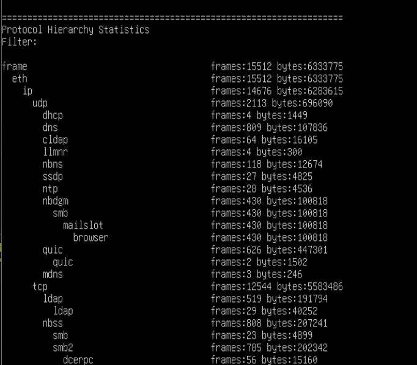
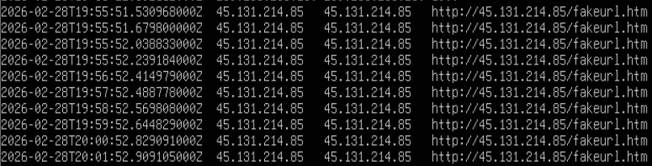

# Pcap Analysis Report

- **File:** 2026-02-28-traffic-analysis-exercise.pcap
- **Source:** https://www.malware-traffic-analysis.net/2026/02/28/index.html
- **Analysis date:** 19 Nov 2026
- **Capture duration:** 15,689 s (≈ 4 h 21 min)
- **Analyst:** Ryan Lam
- **Severity:** High
- **Quick verdict:** True positive

## 1. Summary (2–3 sentences)
The victim, Becka Rolf (username `brolf`), was likely tricked into installing a trojan (NetSupport RAT) on host DESKTOP-TEYQ2NR (10.2.28.88). Since then, her machine has sent a request every 60 seconds to the C2 server 45.131.214[.]85 (domain vadusa[.]xyz) to wait for the attacker's commands. This activity lasted from 19:55 to 00:16 UTC.

Severity: High, because the attacker can freely send commands to the victim's machine, for example to download more malware or steal files containing sensitive information.
Verdict: True positive

## 2. Hosts
| IP              | MAC               | Hostname        | Role (client/server/gateway/DNS) |
| --------------- | ----------------- | --------------- | -------------------------------- |
| 10.2.28.88      | 00:19:d1:b2:4d:ad | DESKTOP-TEYQ2NR | Infected client                  |
| 10.2.28.1       | 14:b3:1f:2d:ce:69 |                 | Default gateway                  |
| 10.2.28.2       | 14:b3:1f:2d:ce:69 | EASYAS123-DC    | Domain controller                |
| 45.131.214[.]85 |                   |                 | External C2 server               |

## 3. Main protocols (Protocol Hierarchy)
- 
- Network: Windows/AD traffic (Kerberos, LDAP, SMB2, DNS), plus cleartext HTTP on port 443, which is the C2 channel.

## 4. Timeline
| Time (UTC)                 | Event                                    | Packet # | Filter used                                                                                                                                            |
| -------------------------- | ---------------------------------------- | -------- | ------------------------------------------------------------------------------------------------------------------------------------------------------ |
| 2026-02-28 19:55:51.25 UTC | DNS query for vadusa[.]xyz               | 2566     | dns.qry.name contains "vadusa"                                                                                                                         |
| 2026-02-28 19:55:51 UTC    | Client first talks to the attacker's IP  | 2569     | tshark -r $F -Y "ip.addr == 45.131.214.85" -T fields -e frame.time_utc -e tcp.dstport \| head -3                                                       |
| 2026-02-28 19:55:51 UTC    | First HTTP POST beacon to /fakeurl.htm   | 2638     | tshark -r $F -Y 'http.request.uri contains "fakeurl"' -T fields -e frame.number -e frame.time_utc -e http.request.method -e http.user_agent \| head -5 |
| 2026-03-01 00:16:28 UTC    | Client last talks to the attacker's IP   | 15500    | tshark -r $F -Y "ip.addr == 45.131.214.85" -T fields -e frame.time_utc -e tcp.dstport \| tail -3                                                       |

The screenshot shows the beacon repeating every 60 seconds.

## 5. Suspicious findings / IOCs
| Type (IP/domain/URL/hash) | Value                                               | Reason                           | Evidence                                |
| ------------------------- | --------------------------------------------------- | -------------------------------- | --------------------------------------- |
| Domain                    | vadusa[.]xyz                                        | C2 domain, resolves to the C2 IP | DNS frames 1559/1747/2566, 19:55:51 UTC |
| IP                        | 45.131.214[.]85                                     | NetSupport C2 server             | conv,ip, frame 2566                     |
| URL                       | hxxp://45.131.214[.]85/fakeurl.htm                  | NetSupport beacon path           | Frame 2638+                             |
| User-Agent                | NetSupport Manager/1.3                              | NetSupport client signature      | Frame 2638                              |
| Network pattern           | HTTP POST in cleartext on TCP 443, about every 60 s | Non-standard port use, beaconing | http.request.uri contains "fakeurl"     |

## 6. MITRE ATT&CK
| Tactic              | Technique (ID)                                      | Evidence in pcap                 |
| ------------------- | --------------------------------------------------- | -------------------------------- |
| Command and Control | T1219 Remote Access Software                        | NetSupport Manager RAT           |
| Command and Control | T1071.001 Application Layer Protocol: Web Protocols | HTTP POST `/fakeurl.htm` beacons |
| Command and Control | T1571 Non-Standard Port                             | Cleartext HTTP over TCP 443      |

## 7. Conclusion & recommendations
- **Immediate containment:** Isolate the host (DESKTOP-TEYQ2NR) and block the attacker's IP and domain. Reset the victim's account password and hunt for NetSupport (`client32.exe`) on other hosts.
- **Remediation:**
	- Company side: Reimage the machine or uninstall NetSupport, check for persistence mechanisms, reset `brolf`'s password, and find how the malware got onto the host.
	- User side: Revoke `brolf`'s active sessions — force a log-out of all sessions across email, cloud storage and the corporate VPN.
- **Detection improvements:**
	- Periodic C2 beaconing alert: trigger when an internal host sends outbound packets of consistent size to the same external IP at a regular interval (e.g. 30 s, 60 s).
	- Alert when the User-Agent is `NetSupport Manager`, or when unencrypted HTTP is seen on port 443.
	- Alert on DNS queries for vadusa[.]xyz.

## 8. Exercise questions
| Question                                  | Answer            | How I found it (filter / command)                                                                                                                   |
| ----------------------------------------- | ----------------- | --------------------------------------------------------------------------------------------------------------------------------------------------- |
| IP address of the infected Windows client | 10.2.28.88        | tshark -r $F -Y "ip.addr == 45.131.214.85" -T fields -e ip.src -e ip.dst \| sort \| uniq -c                                                         |
| MAC address                               | 00:19:d1:b2:4d:ad | tshark -r $F -Y "ip.src == 10.2.28.88" -T fields -e eth.src \| sort \| uniq -c                                                                      |
| Host name                                 | DESKTOP-TEYQ2NR   | tshark -r $F -Y "dhcp" -T fields -e ip.src -e dhcp.option.hostname \| sort -u tshark -r $F -Y "nbns" -T fields -e ip.src -e nbns.name \| sort -u |
| User account name                         | brolf             | tshark -r $F -Y "kerberos.CNameString" -T fields -e ip.src -e kerberos.CNameString \| sort \| uniq -c                                               |
| Full name of the user                     | Becka Rolf        | strings -n 6 -el $F \| grep -E '^[A-Z][a-z]+ [A-Z][a-z]+$' \| sort \| uniq -c \| sort -rn \| head -20                                               |
